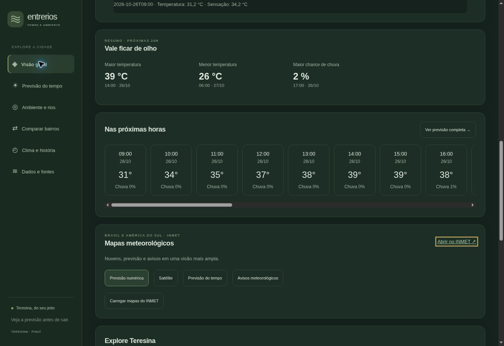

# Entre Rios

Um site para acompanhar o tempo e dados ambientais de Teresina.



A imagem mostra uma consulta de outubro de 2026. Os dados no site são atualizados de acordo com cada fonte.

## O que tem no projeto

- Previsão por bairro, gráficos por hora e previsão para sete dias.
- Comparação de bairros e modelos meteorológicos.
- Mapas e avisos do INMET.
- Dados de chuva, qualidade do ar e da água, focos de fogo e níveis dos rios.
- Histórico regional de temperatura e comparação com a média de 1991 a 2020.
- Temas claro e escuro.

O site reúne previsões, medições e dados históricos, que têm limites diferentes. As fontes e datas aparecem junto às informações. Em caso de avisos ou situações de risco, consulte também os órgãos oficiais.

## Tecnologias

React, TypeScript, Vite, Leaflet, Vinext e Cloudflare Workers.

O frontend fica em `frontend/` e o backend em `backend/`. A pasta `app/` contém os arquivos de entrada das rotas usados pelo Vinext. Os dois compartilham as dependências do projeto.

## Como executar

É preciso ter Node.js 22.13 ou superior e pnpm 11.25.0.

```bash
pnpm install --frozen-lockfile
pnpm dev
```

Abra o endereço informado no terminal. Se editar a interface, gere o bundle novamente com `node scripts/build-react-app.mjs` e recarregue a página.

Para verificar o projeto:

```bash
pnpm test
pnpm typecheck
pnpm lint
pnpm build
```

## Dados

O projeto usa informações de Open-Meteo, INMET, INPE, CEMADEN, SEMARH-PI, SGB, NASA POWER e IBGE. O mapa usa [OpenStreetMap](https://www.openstreetmap.org/copyright).

- [Fontes e metodologia](docs/DATA_SOURCES.md)
- [Organização do projeto](docs/ARCHITECTURE.md)

O código está sob a [licença MIT](LICENSE). As fontes e dependências têm seus próprios termos de uso.
